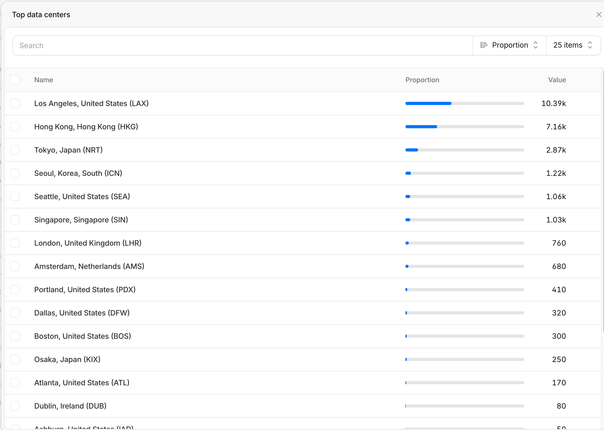

baseballchart.kr은 서버 1대입니다. 사용자가 대부분 국내라서 서버는 당연히 국내에 있습니다. 2 vCPU + 1G 램으로 구성된 저가형 서비스인 AWS 서울 리전에 있는 Lightsail입니다.  

그리고 앞단에 CDN으로 Cloudflare를 두었습니다. 물론 Cloudflare 프리 요금제라 추가 비용은 없습니다. CDN을 둔 이유는 AI 추천이었습니다. DDoS 공격이나 악의적으로 스크립트를 만들어서 짧은 시간에 반복해서 차트 그리기를 누르는 것까지 막아 줄 거라 기대했습니다. 그리고 서버 IP를 감추는 보안상 이점이 있습니다. 그래서 Cloudflare IP 대역이 아닌 곳에서의 접속은 nginx 단에서 막았습니다.  

‘차트 그리기’를 누르면 OpenRouter를 통해 LLM(현재는 Google Gemini)을 이용합니다. OpenRouter의 입구는 인천/서울인 것을 확인했고 LLM은 미국에 있을 가능성이 매우 높아서 차트 그리기를 하면 태평양을 1회 왕복합니다. 태평양 왕복은 한 번에 0.1~0.2초 정도인데, 차트 하나에 걸리는 7~12초는 대부분 LLM 모델이 답을 만드는 시간입니다. 따라서 LLM이 미국 본토에 있어서 주는 손해는 상대적으로 미미 합니다.  

그런데 특이한 현상을 발견했습니다. ‘차트 그리기’ 버튼 이외에는 LLM을 타지 않는데 다른 클릭에서 3초 이상 걸리는 경우가 자주 있습니다. 예를 들면 예시 질문에 있는 버튼을 누르면 단순히 질문 창에 미리 작성한 예시 질문을 입력해 주는 단순한 작업인데도 3초가 걸립니다.  

확인 결과 종종 느린 원인을 찾았습니다. 우리 서버 앞단에 있는 Cloudflare 엣지 서버(Edge Server)가 한국이 아니라 미국에 있는 겁니다. 사용자는 한국에 있고 우리 서버는 서울 리전에 있는데 Cloudflare 엣지 서버가 미국에 있으니 뭐든지 태평양을 두 번 왕복하게 됩니다.  

**방문자(한국) → Cloudflare LAX → 서울 서버 → Cloudflare LAX → 방문자(한국)**

아래 화면은 Cloudflare 웹 콘솔 Analytics 메뉴에서 지난 30일 동안의 Requests 통계를 Filter를 Country equals South Korea로 지정해서 확인한 화면입니다. 즉, 한국에서 들어오는 트래픽이 어느 엣지 서버를 거쳤나입니다. 로스앤젤레스인 LAX가 1/3을 차지하며 1위이고 그 다음 홍콩, 도쿄 순입니다. 가장 가까운 서울(실제로는 ICN이니 인천)은 4위인데 퍼센티지로는 1/10도 안 됩니다.  

클로드 코드가 찾아 준 개발자 후기에는 Cloudflare를 유료 요금제인 Pro(연간 결제 시 월 $20, 월 결제 시 $25)로 올리자 바로 국내 거점으로 바뀌었다는 사례와 Pro에서도 LAX로 간다는 사례가 둘 다 있습니다. 국내 거점(ICN)을 확실히 받으려면 그 이상 요금제가 필요하다는 글도 있습니다.  

**결론적으로 Cloudflare를 걷어냈습니다.** 걷어내면서 잃은 것은 두 가지입니다. 하나는 DDoS 방어인데 DDoS 공격을 받을 만큼 유명한 서비스가 아니라서 걱정이 없습니다. 다른 하나는 서버 IP가 이제 드러난다는 점입니다. 그래도 반복 클릭은 처음부터 Cloudflare가 아니라 nginx 단계와 그 이후 app 단계에서 막고 있었습니다. 짧은 시간 안에 허용치를 넘어서면 자동으로 적절한 조치를 합니다.  

Cloudflare를 걷어내면서 확실히 사용자 체감 속도가 빨라졌습니다. 홍콩·도쿄가 아니라 최악인 LA를 두 번 왕복하는 일이 없어졌으니까요. 같은 PC에서 같은 방법으로 서버에 간단한 요청을 보내 응답 시간을 재 보았습니다.  

| | 접속 지점 | 응답 시간 |
|---|---|---|
| 걷어내기 전 (11/6, 7회) | LAX | 1.3~2.9초 |
| 걷어낸 뒤 (11/12, 10회) | 서울 직접 | 0.036~0.049초 |

약 40배 빨라졌습니다. 다만 집 회선 한 곳에서 잰 값입니다.  

그리고 이번 일을 겪으면서 플러스로 하나 더 소득이 있었습니다. 예시 질문을 누르면 서버를 거칠 이유가 없는데 지금까지 서버에서 처리를 하고 있었습니다. 예시 질문은 자주 바뀌는 내용도 아니고 충분히 브라우저에서 저장해서 처리할 수 있는데 클로드 코드가 서버에서 처리하게 개발해 놓은 것을 알게 되었습니다. 브라우저에서 처리하도록 수정해서 이제는 예시 질문을 누르면 서버로 가지도 않아서 빛의 속도로 바뀝니다.

P.S.  
상단 우측에 있는 3종 세트인 드래프트, 선수 이동, 역대 감독 페이지는 LLM과는 아무 상관 없고 구운 화면입니다. 따라서 한 번 가져오면 1시간 이후 캐시가 만료되기 전까지는 그 화면 안의 검색·슬라이더·툴팁이 서버 없이 브라우저에서만 처리됩니다. 그래서 체감 속도가 엄청 빠릅니다. 의견 보내기나 아직 열어 보지 않은 다른 화면처럼 서버가 필요한 것은 예외입니다.
